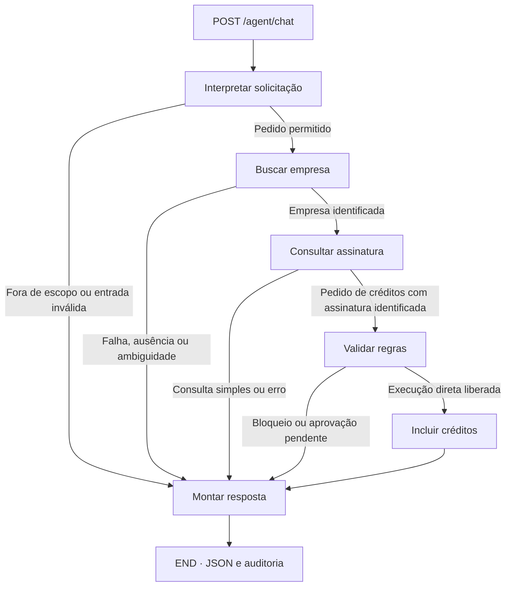

# AcreditAi — Copiloto Operacional de Créditos B2B

AcreditAi é um copiloto operacional de Customer Success B2B, implementado como um agente de IA com LangChain e LangGraph para consultar assinaturas e conceder créditos de API sob regras de negócio e com opção de supervisão humana.

Os detalhes da arquitetura, das regras de negócio, dos contratos da API e da interface estão na [Especificação de Design de Software (SDD)](sdd-acreditai.md).


## Arquitetura do Sistema

```text
+-------------------------------------------------------------------+
|                     Analista de CS / Supervisor                   |
+---------------------------------+---------------------------------+
                                  |
                 +----------------+----------------+
                 |                                 |
                 v                                 v
+---------------------------------+   +-----------------------------+
| Interface Web (Streamlit)       |   | Clientes REST / Swagger     |
| - Chat Operacional + Contexto   |   | - POST /agent/chat          |
| - Centro de Aprovações (HITL)   |   | - GET  /agent/aprovacoes    |
| - Desambiguação Interativa      |   | - POST /agent/aprovacoes/id |
| - Histórico e Trilha Auditoria  |   | - GET  /agent/auditoria     |
+----------------+----------------+   +--------------+--------------+
                 |                                   |
                 +-----------------+-----------------+
                                   |
                                   v
+-------------------------------------------------------------------+
|                    FastAPI Agent Service (acreditai)              |
+----------------------------------+--------------------------------+
                                   |
                                   v
+-------------------------------------------------------------------+
|               LangGraph Orchestrator (StateGraph)                 |
|  [Interpretar] -> [Buscar Empresa] -> [Validar / Desambiguar]     |
|        -> [Consultar Assinatura] -> [Validar Regras]              |
|        -> [Gate HITL / Interrupt] -> [Incluir Créditos] -> [END]  |
+--------+-------------------------+-----------------------+--------+
         |                         |                       |
         v                         v                       v
  buscar_empresa         consultar_assinatura      incluir_creditos
         |                         |                       |
         +-------------------------+-----------------------+
                                   | HTTP (httpx + Pydantic)
                                   v
+-------------------------------------------------------------------+
|               SaaS API Base (FastAPI + PostgreSQL)                |
|  GET /empresas?nome= | GET /assinaturas/{id} | POST .../creditos  |
+-------------------------------------------------------------------+
```

## Fluxo no LangGraph

O analista usa o Streamlit ou chama o FastAPI diretamente. O LangChain extrai
intenção e parâmetros com saída Pydantic. O `StateGraph` mantém um `AgentState`
tipado com mensagem, intenção, empresa e assinatura, quantidade, saldo,
contador de passos, status e trilha de auditoria.



| Ferramenta LangChain | Rota do SaaS | Responsabilidade |
| --- | --- | --- |
| `buscar_empresa` | `GET /empresas?nome=...` | Localizar empresas pelo nome fantasia. |
| `consultar_assinatura` | `GET /assinaturas/{empresa_id}` | Obter plano, status e saldo vigente. |
| `incluir_creditos` | `POST /assinaturas/{assinatura_id}/creditos` | Enviar quantidade e justificativa e ler o saldo devolvido pelo SaaS. |

A API do agente expõe `POST /agent/chat`, `GET /agent/aprovacoes`,
`POST /agent/aprovacoes/{execucao_id}/decidir`, `GET /agent/historico` e
`GET /agent/auditoria/{execucao_id}`. As pendências e o histórico ficam em
SQLite. A decisão autenticada retoma a execução pela API. Se selecionar a
empresa ainda deixar uma aprovação obrigatória, a concessão continua pendente.

## Limites e riscos

- O agente consulta empresas e assinaturas e concede créditos. Mudança de plano,
  cancelamento, exclusão ou edição cadastral e estorno ficam fora do escopo.
  A credencial do agente também tem acesso limitado a essas três operações no SaaS.
- A concessão exige assinatura ativa e quantidade inteira entre **1 e 3.000**
  por operação. O código valida essas regras antes do POST, inclusive quando
  o texto pede para ignorá-las. O grafo tem limite de 10 passos por padrão.
- Uma busca sem resultados encerra com motivo. Várias empresas exigem seleção
  entre as candidatas. Várias assinaturas para a empresa interrompem a concessão
  até que seja possível identificar a assinatura com segurança.
- Falhas HTTP, timeout e resposta fora do contrato retornam erro estruturado.
  Após um timeout no POST, consulte o saldo e a auditoria antes de repetir a
  solicitação, pois o SaaS pode ter registrado o crédito.

## Instalação e execução local

Pré-requisitos: Docker com Compose, Python 3.11+ e `uv`. Os comandos abaixo
são para PowerShell com os dois repositórios em `D:/Projects`.

### 1. Subir a API SaaS e o PostgreSQL

```powershell
Set-Location D:/Projects/api-saas
if (-not (Test-Path .env)) { Copy-Item .env.example .env }
```

Defina um valor secreto em `SAAS_API_TOKEN` no `.env` do SaaS. Para acessar
rotas administrativas, use um `SAAS_ADMIN_TOKEN` distinto.

```powershell
docker compose up -d --build
docker compose ps
Invoke-RestMethod http://127.0.0.1:8002/health
```

A API responde na porta `8002` e executa as migrações ao iniciar.

### 2. Configurar e iniciar o agente

```powershell
Set-Location D:/Projects/acreditai
if (-not (Test-Path .env)) { Copy-Item .env.example .env }
uv sync
```

No `.env` do agente, informe `OPENAI_API_KEY`, configure
`SAAS_API_URL=http://127.0.0.1:8002` e use o mesmo `SAAS_API_TOKEN` do SaaS.
Para aprovações, configure um token por supervisor em
`ACREDITAI_APROVADORES='{"Supervisor CS":"<token-secreto>"}'`. O nome da
auditoria vem da credencial fornecida como Bearer token.

```powershell
uv run uvicorn acreditai.api.main:app --host 127.0.0.1 --port 8010
```

Abra o Swagger em `http://127.0.0.1:8010/docs`. Para usar o Streamlit,
abra outro terminal na raiz do AcreditAi.

```powershell
$env:ACREDITAI_API_URL = 'http://127.0.0.1:8010'
uv run streamlit run src/acreditai/ui/app.py
```

## Demonstração em um único deploy

O modo demo executa o LangGraph no Streamlit e usa OpenAI ou Groq para interpretar
as solicitações. Empresas, assinaturas, saldos e registros de execução são
fictícios e isolados por sessão. O visitante pode decidir as aprovações da sua
sessão e usar **Reiniciar demonstração** para restaurar os dados iniciais.

No Streamlit Community Cloud, selecione a branch publicada e use
`src/acreditai/ui/app.py` como arquivo principal. Configure os Secrets:

```toml
ACREDITAI_MODE = "demo"
OPENAI_API_KEY = "sua-chave"
```

Para usar Groq no lugar da OpenAI, configure estes valores nos Secrets do deploy
ou no `.env` local. O modelo padrão do Groq é `openai/gpt-oss-20b`.

```toml
ACREDITAI_LLM_PROVIDER = "groq"
GROQ_API_KEY = "sua-chave-groq"
```

O valor opcional `GROQ_MODEL` permite selecionar outro modelo com suporte a
chamadas de ferramentas. O provedor padrão é `openai`.

Para testar localmente no PowerShell, configure a chave no `.env` ou no ambiente:

```powershell
$env:ACREDITAI_MODE = 'demo'
uv run streamlit run src/acreditai/ui/app.py
```

Experimente **Consulte o saldo da Logística Sul**, **Adicione 1500 créditos para a
Logística Sul** ou **Consulte o saldo da Horizonte**. Cada mensagem do chat usa
a chave do provedor configurado. O FastAPI e a API SaaS são necessários no modo integrado.

Informe o token de supervisor na área de Aprovações. Execute a suíte local
com `uv run pytest -v`.

## Evidências dos três cenários

A API do agente foi exercitada com FastAPI TestClient e interpretação do LLM
simulada. As chamadas do cliente SaaS foram reais, com PostgreSQL 17 via Docker.
No cenário nominal, uma consulta antes e outra após o POST confirmaram o
incremento persistido de 1.500 créditos. Os JSONs abaixo foram capturados na
execução de verificação.

Para reproduzir no Swagger, abra `http://127.0.0.1:8010/docs`, expanda
`POST /agent/chat`, selecione **Try it out**, cole cada requisição abaixo e
clique em **Execute**. No Postman, envie as mesmas requisições para
`http://127.0.0.1:8010/agent/chat` com `Content-Type: application/json`.
O cenário nominal altera o saldo do banco de desenvolvimento a cada execução.

### 1. Fluxo nominal

`POST /agent/chat`

```json
{
  "mensagem": "Adicione 1500 créditos para Logística Sul",
  "exigir_aprovacao": false
}
```

Resposta HTTP 200

```json
{
  "execucao_id": "EXEC-2026-E2D978",
  "status": "concluido",
  "motivo": null,
  "empresa": {
    "empresa_id": 1,
    "nome": "Logística Sul"
  },
  "empresas_candidatas": [
    {
      "id": 1,
      "nome_fantasia": "Logística Sul",
      "cnpj": "11.222.333/0001-44",
      "dominio_corporativo": "logisticasul.com.br"
    }
  ],
  "assinatura": {
    "assinatura_id": 10,
    "plano": "STARTER",
    "status": "ATIVA"
  },
  "creditos": {
    "saldo_anterior": 1200,
    "creditos_adicionados": 1500,
    "creditos_solicitados": 1500,
    "saldo_final": 2700
  },
  "auditoria": [
    {
      "etapa": "Interpretar Solicitação",
      "status": "sucesso",
      "detalhe": "Intenção: incluir_creditos | Empresa: Logística Sul | Créditos: 1500",
      "timestamp": "2026-11-24 14:15:31 UTC"
    },
    {
      "etapa": "Buscar Empresa",
      "status": "sucesso",
      "detalhe": "Empresa única localizada: Logística Sul (ID: 1).",
      "timestamp": "2026-11-24 14:15:34 UTC"
    },
    {
      "etapa": "Consultar Assinatura",
      "status": "sucesso",
      "detalhe": "Assinatura ID 10 | Plano: STARTER | Status: ATIVA | Saldo: 1200",
      "timestamp": "2026-11-24 14:15:38 UTC"
    },
    {
      "etapa": "Validar Regras",
      "status": "sucesso",
      "detalhe": "Assinatura ATIVA e quantidade (1500 <= 3000) aprovadas.",
      "timestamp": "2026-11-24 14:15:38 UTC"
    },
    {
      "etapa": "Incluir Créditos",
      "status": "sucesso",
      "detalhe": "Adicionados +1500 créditos na assinatura 10. Novo saldo: 2700.",
      "timestamp": "2026-11-24 14:15:41 UTC"
    }
  ]
}
```

### 2. Empresa ambígua

`POST /agent/chat`

```json
{
  "mensagem": "Adicione 500 créditos para Alpha",
  "exigir_aprovacao": true
}
```

Resposta HTTP 200

```json
{
  "execucao_id": "EXEC-2026-E583AD",
  "status": "aguardando_desambiguacao",
  "motivo": "Foram encontradas 2 empresas para 'Alpha'. Selecione qual deseja utilizar.",
  "empresa": null,
  "empresas_candidatas": [
    {
      "id": 3,
      "nome_fantasia": "Alpha Varejo Brasil",
      "cnpj": "33.444.555/0001-66",
      "dominio_corporativo": "alphavarejo.com.br"
    },
    {
      "id": 4,
      "nome_fantasia": "Alpha Cloud Sistemas",
      "cnpj": "44.555.666/0001-77",
      "dominio_corporativo": "alphacloud.com.br"
    }
  ],
  "assinatura": null,
  "creditos": null,
  "auditoria": [
    {
      "etapa": "Interpretar Solicitação",
      "status": "sucesso",
      "detalhe": "Intenção: incluir_creditos | Empresa: Alpha | Créditos: 500",
      "timestamp": "2026-11-24 14:15:41 UTC"
    },
    {
      "etapa": "Buscar Empresa",
      "status": "alerta",
      "detalhe": "Foram encontradas 2 empresas para 'Alpha'. Selecione qual deseja utilizar.",
      "timestamp": "2026-11-24 14:15:44 UTC"
    }
  ]
}
```

### 3. Limite excedido

`POST /agent/chat`

```json
{
  "mensagem": "Adicione 5000 créditos para Logística Sul",
  "exigir_aprovacao": false
}
```

Resposta HTTP 200

```json
{
  "execucao_id": "EXEC-2026-A469DB",
  "status": "negado",
  "motivo": "Operação negada: a quantidade solicitada (5000) excede o limite operacional máximo de 3000 créditos por operação.",
  "empresa": {
    "empresa_id": 1,
    "nome": "Logística Sul"
  },
  "empresas_candidatas": [
    {
      "id": 1,
      "nome_fantasia": "Logística Sul",
      "cnpj": "11.222.333/0001-44",
      "dominio_corporativo": "logisticasul.com.br"
    }
  ],
  "assinatura": {
    "assinatura_id": 10,
    "plano": "STARTER",
    "status": "ATIVA"
  },
  "creditos": {
    "saldo_anterior": 2700,
    "creditos_adicionados": 0,
    "creditos_solicitados": 5000,
    "saldo_final": 2700
  },
  "auditoria": [
    {
      "etapa": "Interpretar Solicitação",
      "status": "sucesso",
      "detalhe": "Intenção: incluir_creditos | Empresa: Logística Sul | Créditos: 5000",
      "timestamp": "2026-11-24 14:15:44 UTC"
    },
    {
      "etapa": "Buscar Empresa",
      "status": "sucesso",
      "detalhe": "Empresa única localizada: Logística Sul (ID: 1).",
      "timestamp": "2026-11-24 14:15:47 UTC"
    },
    {
      "etapa": "Consultar Assinatura",
      "status": "sucesso",
      "detalhe": "Assinatura ID 10 | Plano: STARTER | Status: ATIVA | Saldo: 2700",
      "timestamp": "2026-11-24 14:15:51 UTC"
    },
    {
      "etapa": "Validar Regras",
      "status": "bloqueado",
      "detalhe": "Operação negada: a quantidade solicitada (5000) excede o limite operacional máximo de 3000 créditos por operação.",
      "timestamp": "2026-11-24 14:15:51 UTC"
    }
  ]
}
```
